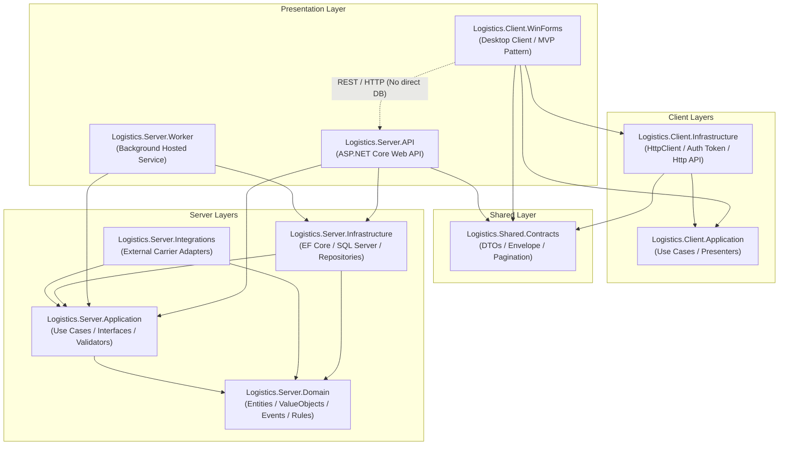

# Architecture Guide: Logistics Management System

## 1. Architectural Style & Principles

The solution follows **Clean Architecture** combined with a **Modular Monolith** structure for the domain.

### Strict Architectural Invariants

1. **Independent Domain**: `Logistics.Server.Domain` has **zero** dependencies on EF Core, ASP.NET Core, or other external infrastructure.
2. **Client Isolation**: `Logistics.Client.WinForms` and its client layers **NEVER** access the SQL database directly. All interaction must pass through HTTP REST APIs via `IApiClient`.
3. **Dependency Inversion**: Core application logic depends only on abstractions (`IRepository<T>`, `IUnitOfWork`, `ICacheService`, etc.). Infrastructure implements those interfaces.
4. **Shared Contracts**: `Logistics.Shared.Contracts` contains only plain data contracts (request/response envelopes, pagination models, health DTOs). It contains no domain entities or EF Core configurations.

---

## 2. Project Responsibilities

| Project | Responsibility | Dependencies |
| :--- | :--- | :--- |
| **`Logistics.Server.Domain`** | Enterprise business rules, entities (`BaseEntity`), domain events (`IDomainEvent`), value objects (`ValueObject`), smart enums (`Enumeration`), result types (`Result<T>`), and domain exceptions. | None |
| **`Logistics.Server.Application`** | Application business logic, commands, queries, application service interfaces (`IRepository`, `IUnitOfWork`, `ICacheService`), and validation. | `Domain` |
| **`Logistics.Server.Infrastructure`** | Persistence implementations via EF Core `ApplicationDbContext`, SQL Server mapping, and caching abstraction implementations. | `Application`, `Domain` |
| **`Logistics.Server.Integrations`** | Carrier integration adapters (`ICarrierAdapter` for GHN, GHTK, Viettel Post) and Email provider (`IEmailProvider` for SendGrid / SMTP). | `Application`, `Domain` |
| **`Logistics.Server.API`** | ASP.NET Core Web API, controllers, Swagger/OpenAPI documentation, Serilog logging, and global exception handling middleware. | `Application`, `Infrastructure`, `Shared.Contracts` |
| **`Logistics.Server.Worker`** | Background processing hosted service for Outbox dispatching, Notification delivery, Background job queue/reports/maintenance, and Carrier tracking sync. | `Application`, `Infrastructure`, `Integrations` |
| **`Logistics.Shared.Contracts`** | Common API request/response contracts (`ApiResponse<T>`), pagination contracts (`PagedRequest`, `PagedResponse<T>`), and health check models. | None |
| **`Logistics.Client.Application`** | Client use cases, presentation logic, view interfaces (`IDashboardView`), and presenters (`DashboardPresenter`) following the MVP pattern. | `Shared.Contracts` |
| **`Logistics.Client.Infrastructure`** | HTTP communication (`ApiClient` via `HttpClientFactory`), API options, authentication token management abstractions. | `Client.Application`, `Shared.Contracts` |
| **`Logistics.Client.WinForms`** | Windows Forms desktop UI shell, sidebar navigation, top header, status bar, and module `UserControl` containers. | `Client.Application`, `Client.Infrastructure`, `Shared.Contracts` |
| **`Logistics.Server.UnitTests`** | Automated unit tests for Domain logic, BaseEntity, ValueObject, and Result types. | `Server.Domain`, `Server.Application` |
| **`Logistics.Server.IntegrationTests`**| Automated end-to-end integration tests using `WebApplicationFactory` and in-memory test databases. | `Server.API`, `Server.Infrastructure` |
| **`Logistics.Client.UnitTests`** | Automated client unit tests for Presenters and UI logic with Mocking. | `Client.Application` |

---

## 3. Modular Monolith Directory Plan

To support long-term modular monolith growth without structural churn, the following 12 domain modules map cleanly across the solution:

1. **Identity & Access Management**: Authentication, roles, permissions, JWT tokens.
2. **Organization & Branch Management**: Company hierarchy, branches, hubs, distribution centers.
3. **Customer Management (CRM)**: Shippers, consignees, contacts, credit limits.
4. **Order Management**: Order creation, tracking, status transitions, cancellation.
5. **Shipment Management**: Waybills, dispatching, route assignment, proof of delivery (POD).
6. **Carrier Integration**: External carrier adapters (GHN, GHTK, Viettel Post, custom 3PLs).
7. **Warehouse Management**: Warehouses, zones, bins, cross-docking facilities.
8. **Inventory Management**: Stock on hand, SKU tracking, reserved inventory, cycle counting.
9. **Finance & COD Management**: Cash-on-delivery tracking, carrier reconciliation, customer billing.
10. **Notification Management**: Email, SMS, webhooks, real-time push notifications.
11. **Reporting & Analytics**: Read-only role/branch-scoped dashboards, operational/financial/COD reports, safe CSV export, and background scheduled CSV execution (`docs/reporting/`).
12. **Audit Logging**: Immutable audit trail of critical operational and security actions.
