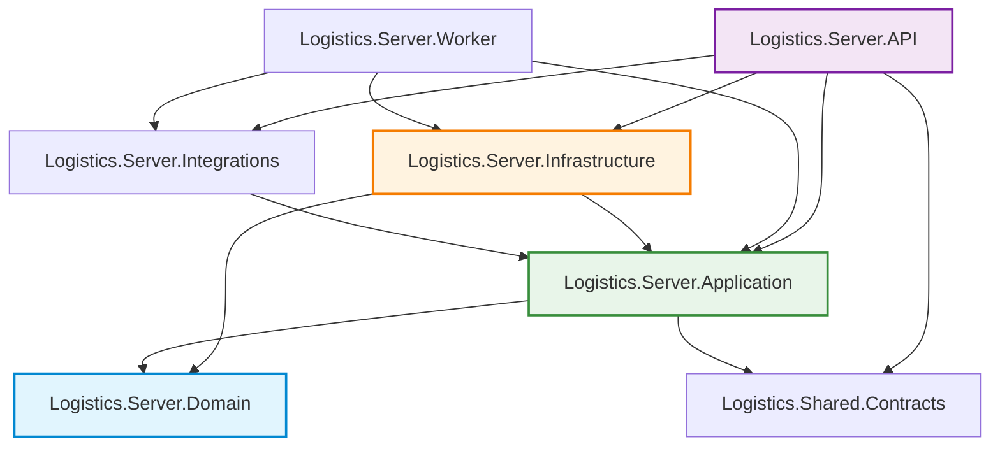

# Backend Architecture Specification

## 1. Architectural Overview & Responsibilities

The backend is built as a **Modular Monolith** using **Clean Architecture** principles in **.NET 9.0**. It serves a WinForms Desktop Client and integrates external shipping carriers, inventory warehouses, parcel hubs, and internal accounting.

### Solution Layout

```text
src/
├── Server/
│   ├── Logistics.Server.Domain/           # Enterprise domain rules, entities, enums, value objects, domain exceptions
│   ├── Logistics.Server.Application/      # Use cases, module services, DTOs, FluentValidation, interfaces
│   ├── Logistics.Server.Infrastructure/   # ApplicationDbContext (EF Core 90 tables), repositories, user context
│   ├── Logistics.Server.Integrations/     # Carrier integration adapters (GHN, GHTK, ViettelPost) and factories
│   ├── Logistics.Server.API/              # Controllers, middlewares, JWT auth setup, Swagger, health checks
│   └── Logistics.Server.Worker/           # Background hosted services (Outbox processor, Tracking sync)
├── Client/
│   ├── Logistics.Client.Application/      # Client business logic and state management
│   ├── Logistics.Client.Infrastructure/   # API HTTP client communication
│   └── Logistics.Client.WinForms/         # Windows Forms desktop presentation UI
└── Shared/
    └── Logistics.Shared.Contracts/        # Common API contracts, DTOs, pagination models, responses
```

---

## 2. Layer Responsibilities & Dependency Inversion



1. **Logistics.Server.Domain**:
   - Zero external framework dependencies (pure C#).
   - Contains all 90 domain entities mapped across 14 schemas.
   - Dual-key pattern: `Id` (BIGINT IDENTITY surrogate PK) and `PublicId` (UUID/GUID for client/API exposure).
   - Audit trail properties (`CreatedAt`, `CreatedBy`, `UpdatedAt`, `UpdatedBy`, `RowVersion`).
   - Domain events and business invariants.

2. **Logistics.Server.Application**:
   - Depends only on Domain and Shared Contracts.
   - Contains CQRS/Application use-case services (`ICompanyService`, `IBranchService`).
   - Request and response DTOs organized by business module (`Modules/Organization`, `Modules/Identity`, `Modules/Crm`, `Modules/Catalog`, `Modules/Sales`).
   - FluentValidation validators for all input contracts.
   - Core interfaces (`IRepository<T>`, `IUnitOfWork`, `ICurrentUserService`, `ICurrentBranchContext`, `ICacheService`).

3. **Logistics.Server.Infrastructure**:
   - Implements data persistence via `ApplicationDbContext` (90 DbSets across 14 schemas).
   - EF Core 9 entity configurations applying constraints, check constraints, schema isolation, and indexing.
   - Auto-population of `PublicId`, timestamps, and audit actor fields in `SaveChangesAsync`.
   - `CurrentUserService` extracting claims (`sub`, `employee_id`, `branch_id`, `branch_access`, `roles`) from `IHttpContextAccessor`.
   - `CurrentBranchContext` extracting active operational scope from the `X-Branch-Id` header.

4. **Logistics.Server.Integrations**:
   - Houses carrier integration adapters (`GhnCarrierAdapter`, `GhtkCarrierAdapter`, `ViettelPostCarrierAdapter`).
   - Unified `ICarrierAdapterFactory` for resolving carrier adapters by code at runtime.
   - Common integration contracts (`CarrierRateRequest`, `CarrierShipmentRequest`, `CarrierTrackingResult`).

5. **Logistics.Server.API**:
   - Presentation layer hosting ASP.NET Core controllers inheriting from `BaseApiController`.
   - Global exception handling via `GlobalExceptionMiddleware`.
   - Distributed correlation ID propagation via `CorrelationIdMiddleware` (`X-Correlation-Id`).
   - Health checks reporting liveness (`/health`) and readiness (`/health/ready`).
   - OpenAPI/Swagger documentation with JWT Bearer scheme.

6. **Logistics.Server.Worker**:
   - Standalone .NET Host running background daemon tasks.
   - Outbox pattern message dispatcher (`OutboxMessageProcessorJob`).
   - Asynchronous carrier tracking poll/webhook sync (`CarrierTrackingSyncJob`).

---

## 3. Dependency Injection Architecture

Each assembly provides an extension method on `IServiceCollection` to encapsulate its own registrations:

- `builder.Services.AddApplication()`: Scans assembly for FluentValidation validators and registers application services.
- `builder.Services.AddInfrastructure(builder.Configuration)`: Configures SQL Server EF Core DbContext, registers `IUnitOfWork`, `IRepository<>`, `ICurrentUserService`, `ICurrentBranchContext`, and infrastructure service implementations.
- `builder.Services.AddIntegrations()`: Registers carrier adapters and `ICarrierAdapterFactory`.

---

## 4. Database Integration & Dual-Key Identity Strategy

The system connects to Microsoft SQL Server reusing the production database (14 domain schemas, 90 tables).

- **Internal Key (`long Id`)**: Used strictly for foreign key constraints, high-performance clustered index scans, and database joins.
- **External Key (`Guid PublicId`)**: Exposed on all API endpoints and used by the WinForms client to reference records. Prevents enumeration attacks and leaking internal sequence statistics.
- **Auditing**: `ApplicationDbContext.SaveChangesAsync` automatically records `CreatedAt`, `CreatedBy`, `UpdatedAt`, and `UpdatedBy` using the claims resolved from `ICurrentUserService`.

---

## 5. Security & Multi-Branch Context

1. **Authentication**: JWT Bearer authentication configured with customizable Issuer, Audience, and HMAC SHA-256 signing key.
2. **Authorization**: Role-based access control (RBAC) via ASP.NET Core policies and `ClaimsPrincipal` roles.
3. **Branch-Level Scoping**:
   - Employees belong to a `DefaultBranchId` and can be granted multi-branch access via `UserBranchAccess` records.
   - Incoming requests pass `X-Branch-Id` header which is validated by `ICurrentBranchContext.IsAuthorizedForActiveBranch()`.
   - Admins bypass branch restriction; operational staff are strictly bounded to their assigned branches.

---

## 6. Observability, Logging & Correlation

- **Serilog**: Structured logging writing to Console and rolling daily log files (`logs/log-.txt`).
- **Correlation ID**: `CorrelationIdMiddleware` ensures every incoming request has an `X-Correlation-Id` header (either preserved from caller or auto-generated). Pushed to `LogContext` so all log entries for a request include `[CorrelationId]`.
- **Trace Identifier**: `context.TraceIdentifier` is populated with the correlation ID and included in all API error responses.

---

## 7. Testing Strategy

1. **Domain Unit Tests** (`Logistics.Server.UnitTests`): Test entity behaviors, domain events, result patterns, and value objects.
2. **Application Validator Tests** (`Logistics.Server.UnitTests`): Comprehensive validation test coverage for all FluentValidation request contracts.
3. **Database Model Tests** (`Logistics.Server.IntegrationTests`): Verify all 90 entity types, 14 schemas, primary keys, audit properties, and decimal column precision.
4. **API Integration Tests** (`Logistics.Server.IntegrationTests`): Spin up `WebApplicationFactory<Program>` in-memory to verify middleware pipeline, error translation, validation rejection, and end-to-end CRUD operations.

---

## 8. Implemented Business Modules

| Module | Service Namespace | Controllers | Key Services |
|--------|-------------------|-------------|--------------|
| Organization & Employee | `Modules/Organization` | `Companies`, `Branches`, `Departments`, `Employees` | `ICompanyService`, `IBranchService`, `IDepartmentService`, `IEmployeeService` |
| Identity & Auth | `Modules/Identity` | `Auth`, `Users`, `Roles` | `IAuthService`, `IUserService`, `IRoleService` |
| CRM — Customer Management | `Modules/Crm` | `Customers`, `CustomerContacts`, `CustomerAddresses` | `ICustomerService`, `ICustomerContactService`, `ICustomerAddressService` |
| Catalog — Product & Service | `Modules/Catalog` | `ProductCategories`, `Products`, `UnitsOfMeasure` | `IProductCategoryService`, `IProductService`, `IUnitOfMeasureService` |
| Sales — Order Management | `Modules/Sales` | `Orders`, `OrderItems`, `OrderPackages`, `OrderAddresses` | `IOrderService`, `IOrderItemService`, `IOrderPackageService`, `IOrderAddressService`, `INumberSequenceService` |
| Shipping — Shipment Management | `Modules/Shipping` | `Shipments`, `ShipmentPackages`, `ShipmentAddresses`, `PickupRequests`, `ShipmentAssignments`, `DeliveryAttempts`, `ProofOfDelivery`, `ReturnRequests`, `ShipmentRoutes` | `IShipmentService`, `IShipmentPackageService`, `IShipmentAddressService`, `IPickupRequestService`, `IShipmentAssignmentService`, `IDeliveryAttemptService`, `IProofOfDeliveryService`, `IReturnRequestService`, `IShipmentRouteService` |
| Carrier Integration | `Modules/Carrier` & `Logistics.Server.Integrations` | `Carriers`, `CarrierServices`, `CarrierConfigurations`, `CarrierTrackingMappings`, `CarrierTrackingEvents`, `CarrierWebhookLogs`, `CarrierApiLogs`, `CarrierSyncJobs` | `ICarrierManagementService`, `ICarrierServiceManagementService`, `ICarrierConfigurationService`, `ICarrierTrackingMappingService`, `ICarrierIntegrationService`, `ICarrierWebhookService`, `ICarrierApiLogService`, `ICarrierSyncJobService`, `ICarrierTrackingSyncOrchestrator` |
| Warehouse & Inventory | `Modules/Warehouse` | `Warehouses`, `WarehouseReceipts`, `WarehouseDispatches`, `ParcelHandling`, `Inventory` | `IWarehouseManagementService`, `IWarehouseReceiptService`, `IWarehouseDispatchService`, `IParcelHandlingService`, `IInventoryStockService`, `IStockAdjustmentService`, `IStockTransferService`, `IInventoryReservationService`, `IInventoryLotService`, `IInventorySerialService` |
| Finance & Billing | `Modules/Finance` | `RateCards`, `ShippingFees`, `Invoices`, `Payments`, `CustomerBalances`, `FinancialLedger` | `IRateManagementService`, `IShippingFeeCalculationService`, `IShipmentChargeService`, `IInvoiceService`, `IPaymentService`, `ICustomerBalanceService`, `IFinancialLedgerService` |
| Cash on Delivery (COD) | `Modules/Cod` | `CodCollections`, `CodRemittances`, `CodOperations`, `CodReconciliation` | `ICodCollectionService`, `ICodEmployeeService`, `ICodRemittanceService`, `ICodReconciliationService` |

### Sales Module — Architecture Notes

The Sales module introduces the `INumberSequenceService` / `NumberSequenceService` for atomic, concurrent-safe sequential number generation with monthly resets. All order mutations enforce the following state machine:

```
Draft → Confirmed → Processing → Shipped/Delivered
  ↓         ↓           ↓
Cancelled Cancelled  Cancelled (blocked if shipments InTransit/Delivered)
```

Order totals (`TotalWeightKg`, `TotalVolumeCbm`, `DeclaredValue`) are recalculated in-memory whenever packages or items are mutated, before saving to the database.

### Shipping Module — Architecture Notes

The Shipping module acts as the physical execution arm for Logistics. It handles atomic creation from confirmed orders (NumberSequence scope `"WAYBILL"`), snapshot addresses, package volumetric calculations, courier/vehicle assignments, driver arrival/pickup workflows, delivery attempts with failure classification, Proof of Delivery (with signature & photo file references), return handling, and leg-by-leg multi-warehouse routing. Transitions enforce an immutable state machine recorded to `shipping.ShipmentStatusHistories`.

### Warehouse & Inventory Module — Architecture Notes

The Warehouse & Inventory module governs physical facilities across two operational types: storage warehouses and parcel sorting hubs. It manages bin location capacities, receipt putaway workflows, dispatch staging, and high-throughput parcel handling barcode scanning (`Arrived`, `Sorted`, `Bagged`, `Loaded`). In inventory, it enforces perpetual stock transaction recording, stock reservation, stock adjustments, inter-warehouse transfers, lot expiration tracking (FEFO), and serial number tracking.

### Finance & Billing Module — Architecture Notes

The Finance & Billing module governs pricing structures, billing, payment processing, and general ledger journalizing. Key architectural pillars include:
1. **Shipping Fee Calculation Engine**: A 3-tier priority resolution engine (Customer Pricing Rule -> Customer Contract -> Default System Rate Card) determining base tariffs, incremental weight brackets, surcharges, insurance, and COD handling fees.
2. **Billing & Invoices**: Lifecycle from draft staging to formal issuance with immutable line items, automated tax calculation, and auto-numbering via `INumberSequenceService` (`INV-YYYYMM-######`).
3. **Payments & Many-to-Many Allocations**: Supports partial payments, split allocations across invoices, unallocated customer credit, and atomic allocation reversals.
4. **Permanent Financial Ledger**: An immutable double-entry journal tracking receivables (`ReceivableInvoice`), payments (`CustomerPayment`), and cancellations (`InvoiceCancellation`) with continuous running balance computation.
5. **Real-time Credit Exposure & Reconciliation**: Concurrency-safe customer balance tracking with optimistic locking (`RowVersion`) and automated journal reconciliation.

### Cash on Delivery (COD) Module — Architecture Notes

The COD module oversees physical cash collection from consignees upon delivery, driver custody handovers, branch vault verifications, and customer payouts (remittances).
1. **Collection Lifecycle**: Strict status progression (`CollectedByDriver` -> `DepositedToBranch` -> `VerifiedByCashier` -> `RemittedToCustomer`).
2. **Customer Balance Integration**: Verified collections increase `CustomerBalance.TotalCodHoldingAmount`. Remittance confirmation deducts from this holding balance without polluting the corporate revenue ledger with duplicate payment receipts.
3. **Customer Remittance Batching**: Sequential remittance numbering via `INumberSequenceService` (`REM-YYYYMM-######`), automated proportional shipping fee netting, and transactional state rollback on remittance cancellation.
4. **Driver Operations & Vault Reconciliation**: Continuous multi-level reconciliation (`ICodReconciliationService`) auditing driver cash in hand, branch vault pending deposits, and remittance batch item integrity.
5. **Multi-Branch Security Isolation**: Enforces fine-grained permission checks and branch access verification (`UserBranchAccess`), ensuring drivers and cashier staff operate strictly within assigned territorial hubs.
