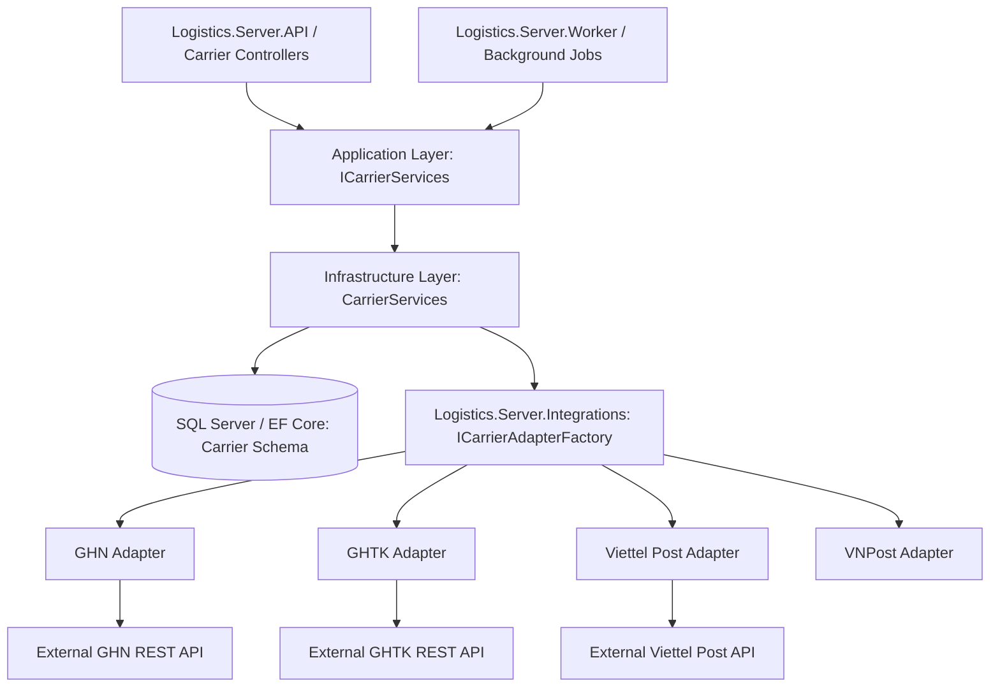

# Carrier Integration Architecture

## 1. Overview & Architectural Principles

The Carrier Integration Module in the Logistics Management System provides a clean, decoupled abstraction between core operational logistics (Orders, Shipments, Warehousing) and diverse third-party external carriers (e.g., Giao Hang Nhanh / GHN, Giao Hang Tiet Kiem / GHTK, Viettel Post / VTPOST, VNPost).

### Architectural Guardrails
1. **Separation of Concerns**: Carrier-specific schemas, protocols, and payload formats do not leak into the internal `Shipping` domain.
2. **Provider Abstraction (`ICarrierAdapter`)**: Operations like rate calculation, shipment booking, cancellation, and tracking are routed through polymorphic carrier adapters resolved at runtime via `ICarrierAdapterFactory`.
3. **Decoupled State Transitions**: Carrier adapters never mutate `Shipment` entities directly. Status updates from tracking sync or webhooks map external carrier codes to internal statuses through `CarrierTrackingMapping` rules, applying the Shipment lifecycle state machine.
4. **Resilience & Non-blocking Ingestion**: Webhooks respond with HTTP 200 immediately upon persistence to `CarrierWebhookLog` and `CarrierTrackingEvent`, ensuring fast response times and decoupled background parsing.
5. **Auditing & Observability**: Every external carrier API invocation is captured in `CarrierApiLog` with latency metrics, HTTP status, and masked payloads.

## 2. Component Interactions

### 2.1 Shipment Booking Flow
1. Operator or business process initiates booking via `POST /api/v1/carrier-integration/book`.
2. `CarrierIntegrationServiceImpl` verifies shipment status and resolves assigned carrier configuration.
3. `CarrierAdapterFactory` resolves adapter matching `Carrier.Code`.
4. Adapter invokes carrier API, returns tracking number and shipping label URL.
5. Shipment is updated with `CarrierTrackingNumber`, transitions to `ReadyForPickup`, and audit log is recorded.

### 2.2 Tracking Synchronization Flow
1. `CarrierTrackingSyncJob` triggers periodically (default: 5 minutes) in the Worker process.
2. `CarrierTrackingSyncOrchestrator` queries active in-transit shipments per carrier.
3. Adapter fetches batch tracking events.
4. Unrecorded events are appended to `CarrierTrackingEvents`.
5. External status is evaluated against `CarrierTrackingMapping`; shipment status advances if mapped.

### 2.3 Webhook Callback Ingestion Flow
1. Carrier posts tracking update payload to `/api/v1/carrier-webhooks/{carrierCode}`.
2. Unauthenticated endpoint logs incoming request to `CarrierWebhookLog`.
3. Event is staged in `CarrierTrackingEvent` for immediate persistence and subsequent reconciliation.
