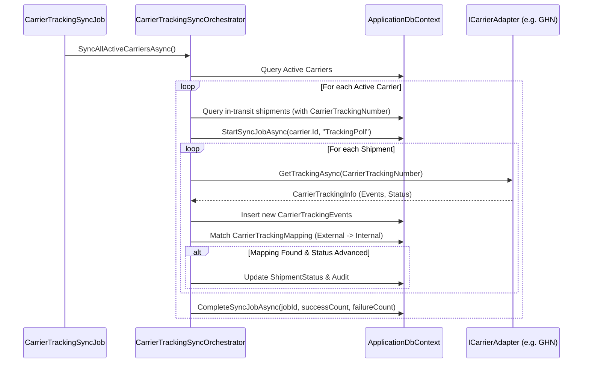

# Carrier Tracking Synchronization Specification

## 1. Synchronization Architecture

The Carrier Tracking Synchronization engine keeps external carrier parcel movement in sync with internal shipment tracking records. It operates via:
1. **Periodic Background Polling**: Executed by `CarrierTrackingSyncJob` hosted in `Logistics.Server.Worker`.
2. **Real-time Webhook Callbacks**: Pushed by carriers upon physical scans and ingested via `CarrierWebhooksController`.

## 2. Status Mapping Engine

External carriers use varied proprietary status codes. The `CarrierTrackingMapping` table normalizes these into the internal Logistics Management system's Shipment state machine.

### Example Mappings:
| Carrier | External Status Code | External Status Name | Internal Shipment Status |
|:---|:---|:---|:---|
| `GHN` | `ready_to_pick` | Đang lấy hàng | `ReadyForPickup` |
| `GHN` | `picking` | Đang lấy hàng | `ReadyForPickup` |
| `GHN` | `picked` | Đã lấy hàng | `PickedUp` |
| `GHN` | `sorting` | Đang phân loại | `InSortingHub` |
| `GHN` | `delivering` | Đang giao hàng | `OutForDelivery` |
| `GHN` | `delivered` | Giao hàng thành công | `Delivered` |
| `GHN` | `delivery_fail` | Giao hàng thất bại | `DeliveryFailed` |
| `GHN` | `returning` | Đang chuyển hoàn | `Returning` |
| `GHN` | `returned` | Đã chuyển hoàn | `Returned` |
| `GHN` | `cancel` | Đã hủy | `Cancelled` |

## 3. Job Execution Tracking: `CarrierSyncJob`

Every tracking sync iteration creates a `CarrierSyncJob` entity recording:
- `JobType`: e.g. `TrackingPoll`
- `StartTime` / `EndTime`
- `Status`: `Running` / `Completed` / `Failed`
- `TotalRecordsProcessed`, `TotalSuccessCount`, `TotalFailureCount`
- `ErrorLog`: Formatted error messages if any shipment synchronization fails.
