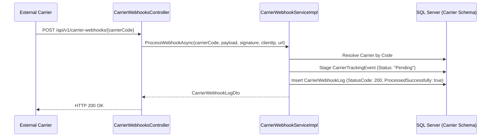

# Carrier Webhook Specification

## 1. Webhook Endpoint Specification

Carriers send asynchronous status update notifications to the public, unauthenticated callback endpoint:

```http
POST /api/v1/carrier-webhooks/{carrierCode}
Content-Type: application/json
X-Webhook-Signature: {hmac_or_token}
```

### Path Parameters
- `carrierCode`: The uppercase carrier identifier (e.g. `GHN`, `GHTK`, `VTPOST`).

### Headers
- `X-Webhook-Signature` (Optional/Carrier specific): Signature hash or token used to verify authenticity.
- `Content-Type`: `application/json`.

## 2. Ingestion & Audit Pipeline



### Non-Blocking Design
- The webhook endpoint immediately persists the raw payload into `CarrierWebhookLog` and inserts a staged `CarrierTrackingEvent`.
- Returns HTTP 200 OK to the external carrier within single-digit milliseconds to avoid carrier webhook timeout penalties.
- Subsequent reconciliation occurs in background or real-time event dispatching.

## 3. Data Schema: `CarrierWebhookLog`

| Column | Type | Description |
|:---|:---|:---|
| `Id` | `BIGINT` | Primary Key |
| `CarrierId` | `BIGINT` | Foreign Key to `Carrier` |
| `ExternalEventId` | `NVARCHAR(100)` | Carrier event/delivery identifier |
| `WebhookUrl` | `NVARCHAR(500)` | Full endpoint URL invoked |
| `HttpMethod` | `NVARCHAR(10)` | HTTP method (POST) |
| `PayloadJson` | `NVARCHAR(MAX)` | Complete raw JSON payload |
| `ResponseStatusCode`| `INT` | HTTP response code returned (200) |
| `ProcessedSuccessfully`| `BIT` | Boolean success flag |
| `ProcessedAt` | `DATETIME2` | Processing timestamp (UTC) |
| `ClientIpAddress` | `NVARCHAR(50)` | Remote caller IP address |
