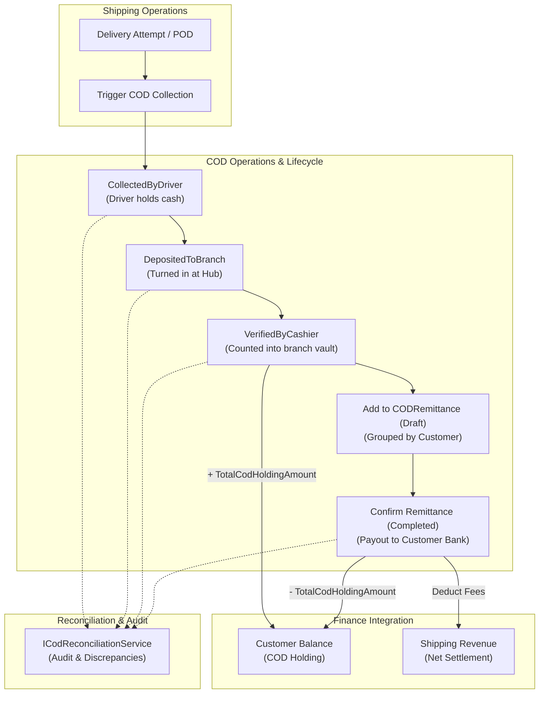
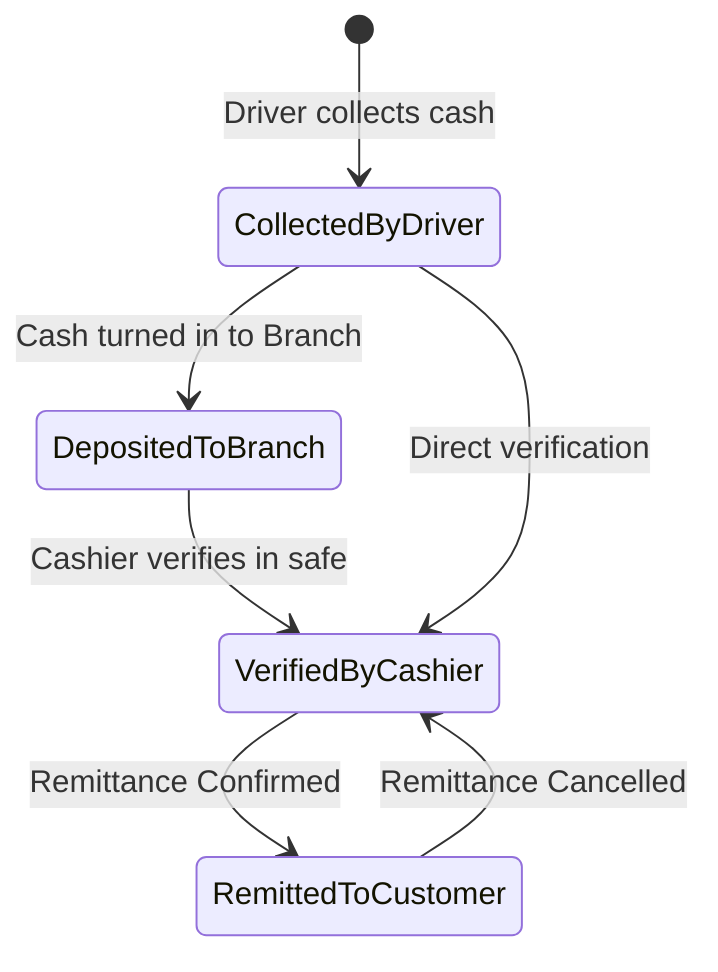
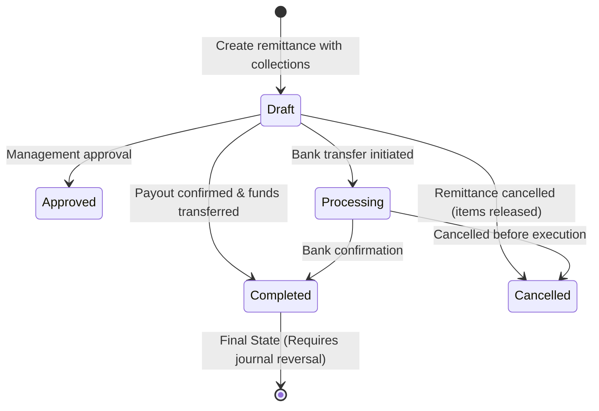

# Cash on Delivery (COD) Architecture Specification

## 1. Architectural Overview & Boundaries

The **Cash on Delivery (COD) Management Module** governs the full lifecycle of physical cash collections from recipients upon package delivery, driver handovers, branch deposit verifications, customer payout batching (remittance), and continuous financial reconciliation within the internal Logistics Management System.

Built within the **Modular Monolith + Clean Architecture** framework (.NET 9.0), the COD module bridges operational transport execution (Shipping Module) with financial accounting (Finance & CRM Modules) under strict multi-branch authorization boundaries.

---

## 2. Clean Architecture Layer Organization

### Domain Layer (`Logistics.Server.Domain.Entities.Finance`)
Zero external dependencies. Leverages the existing schema entities:
- `CODCollection`: The atomic cash collection event tied to a specific shipment, tracked from driver receipt to branch deposit, cashier verification, and customer payout.
- `CODRemittance`: The customer settlement header with sequential remittance number (`REM-YYYYMM-######`), bank details, total COD amount, deducted service fees, and net payout.
- `CODRemittanceItem`: Individual line items linking verified `CODCollection` records to their parent remittance batch with itemized fee deductions.

### Application Layer (`Logistics.Server.Application.Modules.Cod`)
- **DTOs (`DTOs/CodDtos.cs`)**: Strongly typed request/response models for Collections, Remittances, Employee operations, and Reconciliation summaries.
- **Service Interfaces (`Services/ICodServices.cs`)**:
  - `ICodCollectionService`: Collection creation, driver collection updates, branch deposit, cashier verification, and failure tracking.
  - `ICodEmployeeService`: Driver cash holdings, personal collection records, branch-level driver summaries.
  - `ICodRemittanceService`: Remittance drafting, item attachment/detachment, settlement confirmation, and cancellation.
  - `ICodReconciliationService`: High-level reconciliation overview, driver reconciliation, branch vault reconciliation, and remittance batch validation.
- **Validators (`Validators/CodValidators.cs`)**: FluentValidation rules enforcing business invariants.
- **Security (`Common/Security/AppPermissions.Cod`)**: 13 granular permissions governing COD operations.

### Infrastructure Layer (`Logistics.Server.Infrastructure.Services.CodServices.cs`)
- Direct integration with `ApplicationDbContext`, `ICurrentUserService`, `INumberSequenceService`, and `IAuditService`.
- Atomic database updates, branch security isolation, and optimistic concurrency.

### Presentation Layer (`Logistics.Server.API.Controllers.Cod`)
RESTful endpoints following API conventions with route prefixes:
- `/api/v1/cod/collections`
- `/api/v1/cod/remittances`
- `/api/v1/cod/operations`
- `/api/v1/cod/reconciliation`

---

## 3. Core Status Progression

### COD Collection Status

### COD Remittance Status

