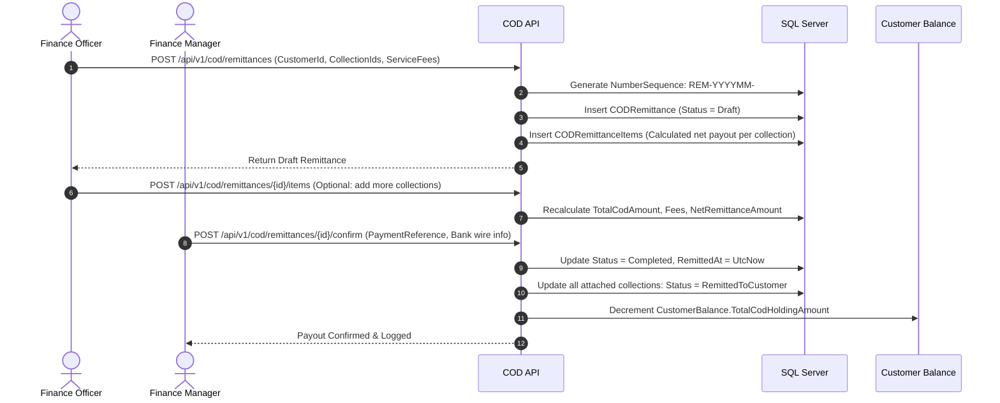

# COD Remittance Management Specification

## 1. Business Concept & Workflow

A **COD Remittance** (`CODRemittance`) represents the formal financial settlement and payout of collected COD funds from the logistics operator to the merchant/shipper (Customer).

---

## 2. Remittance Number Generation

Remittances are assigned human-readable sequential identifiers using the enterprise `INumberSequenceService`:
- **Format**: `REM-YYYYMM-######` (e.g., `REM-202611-000001`).
- **Reset Frequency**: Monthly or continuous sequential numbering.
- Guaranteed uniqueness and thread-safety under concurrent batch creations.

---

## 3. Shipping Fee Deductions & Net Payout

In e-commerce logistics, shippers often opt for **COD Fee Deduction**, where unpaid shipping service fees are automatically subtracted from the COD proceeds before transferring funds to the customer's bank account:

$$\text{NetRemittanceAmount} = \text{TotalCodAmount} - \text{TotalServiceFeesDeducted}$$

### Item-Level Fee Allocation
When total fees are deducted at the batch header, the service proportionally distributes fee deductions across individual remittance items:

$$\text{DeductedFee}_i = \text{Round}\left( \frac{\text{CodAmount}_i}{\text{TotalCodAmount}} \times \text{TotalServiceFeesDeducted}, 2 \right)$$

$$\text{NetAmount}_i = \text{CodAmount}_i - \text{DeductedFee}_i$$

---

## 4. Remittance Lifecycle & State Transitions

| Status | Permitted Actions | Holding Balance Impact | Collection Status |
| :--- | :--- | :--- | :--- |
| `Draft` | Add items, remove items, edit notes, cancel, confirm. | No change (collections reserved). | `VerifiedByCashier` |
| `Approved` | Manager approved; awaiting treasury disbursement. | No change. | `VerifiedByCashier` |
| `Processing` | Wire transfer initiated with bank gateway. | No change. | `VerifiedByCashier` |
| `Completed` | Payment verified transferred to customer bank account. | `TotalCodHoldingAmount -= remittance.TotalCodAmount` | `RemittedToCustomer` |
| `Cancelled` | Remittance voided before disbursement; collections freed. | No change. | `VerifiedByCashier` |

---

## 5. Cancellation & Rollback Guarantees

If a remittance batch is created in error or cancelled before execution:
1. Status is updated to `Cancelled` with mandatory audit reason notes.
2. All linked `CODRemittanceItems` are safely removed from the remittance.
3. All previously attached `CODCollection` records revert to `VerifiedByCashier`, making them immediately available for inclusion in subsequent remittance batches.
4. If a remittance was already `Completed`, cancellation via API is blocked with `409 Conflict`. Reversal of completed bank settlements requires supervisory accounting journal adjustments.
