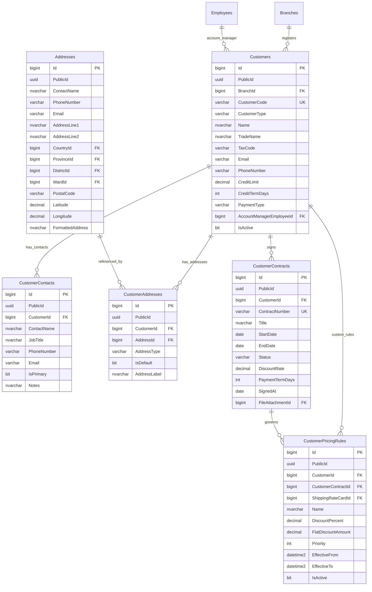

# CRM — Customer Management Module Specification

## 1. Architectural Overview & Responsibilities

The **CRM (Customer Relationship Management)** module governs commercial client accounts, liaisons, physical and billing locations, commercial agreements, and custom pricing exception rules within the internal Logistics Management System.

### Module Architecture

```text
src/Server/
├── Logistics.Server.Domain/
│   └── Entities/Crm/
│       ├── Customer.cs             # Customer account profile
│       ├── CustomerContact.cs      # Contact persons and representatives
│       ├── CustomerAddress.cs      # Junction binding customer to addresses
│       ├── Address.cs              # Normalized geographic address
│       ├── CustomerContract.cs     # Legal service level agreements
│       └── CustomerPricingRule.cs  # Customer custom rate overrides
│
├── Logistics.Server.Application/
│   └── Modules/Crm/
│       ├── DTOs/
│       │   ├── CustomerDto.cs
│       │   ├── CustomerContactDto.cs
│       │   ├── CustomerAddressDto.cs
│       │   ├── CustomerContractDto.cs
│       │   └── CustomerPricingRuleDto.cs
│       ├── Services/
│       │   └── ICrmServices.cs     # 5 module service contracts
│       └── Validators/
│           └── CrmValidators.cs    # FluentValidation input rules
│
├── Logistics.Server.Infrastructure/
│   └── Services/
│       ├── CrmServices.cs          # EF Core implementations with branch isolation
│       └── AuditService.cs         # Audit trail logging
│
└── Logistics.Server.API/
    └── Controllers/Crm/
        ├── CustomersController.cs
        ├── CustomerContactsController.cs
        ├── CustomerAddressesController.cs
        ├── CustomerContractsController.cs
        └── CustomerPricingRulesController.cs
```

---

## 2. Entity Relationships & Domain Design



---

## 3. Branch-Scoped Access Control

Every customer is registered under an operating company branch (`Customer.BranchId`). Access is strictly enforced on both reads and writes:

1. **SuperAdmin / Admin**: Unrestricted global visibility across all customers and branches.
2. **Branch-Scoped Users** (Branch Managers, Customer Service):
   - Only permitted to view and manage customers registered in branches matching their `AccessibleBranchIds` or `DefaultBranchId`.
   - Attempting to view or mutate a customer in another branch yields `403 Forbidden`.
   - Sub-resources (contacts, addresses, contracts, pricing rules) inherit their parent customer's branch authorization automatically.

---

## 4. Audit Trail Integration

All create, update, delete, and status change operations record an immutable audit trail entry in `audit.AuditLogs` via `IAuditService`:
- Captures `UserId`, `Username`, `UserRole`, `IpAddress`, `UserAgent`, and `CorrelationId`.
- Serializes clean before/after snapshots of changed data.
- Prevents object cycle errors through clean DTO mapping and `ReferenceHandler.IgnoreCycles`.
