# Complete Entity-Relationship Diagram (ERD)

This document contains the complete Entity-Relationship Diagram representing all 90 tables across the 14 database schemas of the Logistics Management System.

```mermaid
%% Refer to docs/database/erd-full.mmd for raw mermaid source
erDiagram
    Companies ||--o{ Branches : "has"
    Companies ||--o{ Departments : "operates"
    Branches ||--o{ Departments : "contains"
    Branches ||--o{ Employees : "employs"
    Departments ||--o{ Employees : "assigns"
    Branches ||--o{ Warehouses : "manages"
    Addresses ||--o{ Branches : "locates"
    Addresses ||--o{ Employees : "resides"
    Addresses ||--o{ Warehouses : "locates"

    Employees ||--o| UserAccounts : "authenticates"
    UserAccounts ||--o{ UserRoles : "assigned"
    Roles ||--o{ UserRoles : "bound"
    Roles ||--o{ RolePermissions : "granted"
    Permissions ||--o{ RolePermissions : "entitled"
    UserAccounts ||--o{ UserBranchAccess : "authorized"
    Branches ||--o{ UserBranchAccess : "allows"
    UserAccounts ||--o{ RefreshTokens : "issues"
    UserAccounts ||--o{ UserSessions : "establishes"
    UserAccounts ||--o{ LoginHistories : "audited"

    Countries ||--o{ Provinces : "subdivides"
    Provinces ||--o{ Districts : "subdivides"
    Districts ||--o{ Wards : "subdivides"
    Countries ||--o{ Addresses : "locates"
    Provinces ||--o{ Addresses : "locates"
    Districts ||--o{ Addresses : "locates"
    Wards ||--o{ Addresses : "locates"

    Customers ||--o{ CustomerContacts : "contacts"
    Customers ||--o{ CustomerAddresses : "has_addresses"
    Addresses ||--o{ CustomerAddresses : "referenced_by"
    Customers ||--o{ CustomerContracts : "signs"
    Customers ||--o{ CustomerPricingRules : "negotiates"
    CustomerContracts ||--o{ CustomerPricingRules : "governs"
    Branches ||--o{ Customers : "registers"
    Employees ||--o{ Customers : "manages_account"

    ProductCategories ||--o{ ProductCategories : "subcategorizes"
    ProductCategories ||--o{ Products : "classifies"
    UnitsOfMeasure ||--o{ Products : "measures"
    Currencies ||--o{ Products : "prices"

    Customers ||--o{ Orders : "places"
    Branches ||--o{ Orders : "processes"
    Currencies ||--o{ Orders : "denominates"
    Orders ||--o{ OrderItems : "includes"
    Products ||--o{ OrderItems : "specified_as"
    UnitsOfMeasure ||--o{ OrderItems : "measured_by"
    Orders ||--o{ OrderAddresses : "snapshots"
    Orders ||--o{ OrderPackages : "contains"

    Orders ||--o{ Shipments : "fulfills"
    Customers ||--o{ Shipments : "bills"
    Branches ||--o{ Shipments : "originates"
    Branches ||--o{ Shipments : "delivers_via"
    Carriers ||--o{ Shipments : "transits"
    CarrierServices ||--o{ Shipments : "service_tier"
    Currencies ||--o{ Shipments : "billed_in"

    Shipments ||--o{ ShipmentPackages : "packs"
    OrderPackages ||--o{ ShipmentPackages : "links"
    Shipments ||--o{ ShipmentAddresses : "delivers_to"
    Shipments ||--o{ ShipmentStatusHistories : "tracks"
    Shipments ||--o{ ShipmentAssignments : "assigns"
    Shipments ||--o{ DeliveryAttempts : "attempts"
    Shipments ||--o{ ProofOfDeliveries : "confirms"
    DeliveryAttempts ||--o{ ProofOfDeliveries : "evidences"
    Shipments ||--o{ ReturnRequests : "returns"
    Shipments ||--o{ ShipmentRoutes : "routes"

    Customers ||--o{ PickupRequests : "requests"
    Addresses ||--o{ PickupRequests : "pickup_at"
    Employees ||--o{ PickupRequests : "driver"

    Carriers ||--o{ CarrierServices : "offers"
    Carriers ||--o{ CarrierConfigurations : "configures"
    Carriers ||--o{ CarrierTrackingMappings : "maps"
    Carriers ||--o{ CarrierTrackingEvents : "emits"
    Carriers ||--o{ CarrierWebhookLogs : "posts"
    Carriers ||--o{ CarrierApiLogs : "invokes"
    Carriers ||--o{ CarrierSyncJobs : "polls"

    Warehouses ||--o{ WarehouseZones : "divided_into"
    WarehouseZones ||--o{ WarehouseLocations : "bins"
    Warehouses ||--o{ WarehouseReceipts : "receives"
    WarehouseReceipts ||--o{ WarehouseReceiptItems : "receipt_lines"
    Products ||--o{ WarehouseReceiptItems : "item"
    WarehouseLocations ||--o{ WarehouseReceiptItems : "putaway_to"

    Warehouses ||--o{ WarehouseDispatches : "dispatches"
    WarehouseDispatches ||--o{ WarehouseDispatchItems : "picked_lines"
    Products ||--o{ WarehouseDispatchItems : "item"
    WarehouseLocations ||--o{ WarehouseDispatchItems : "picked_from"
    WarehouseDispatches ||--o{ WarehouseDispatchPackages : "loaded_packages"
    ShipmentPackages ||--o{ WarehouseDispatchPackages : "package"

    ShipmentPackages ||--o{ ParcelHandlingEvents : "scanned"
    Warehouses ||--o{ ParcelHandlingEvents : "facility"

    Products ||--o{ InventoryItems : "stocked_as"
    Warehouses ||--o{ InventoryItems : "facility"
    Products ||--o{ InventoryLots : "lots"
    Products ||--o{ InventorySerialNumbers : "serials"
    Warehouses ||--o{ InventoryBalances : "stocked_at"
    WarehouseLocations ||--o{ InventoryBalances : "located_at"
    Products ||--o{ InventoryBalances : "balance_for"
    InventoryLots ||--o{ InventoryBalances : "lot_split"

    Warehouses ||--o{ InventoryTransactions : "transacted_at"
    InventoryTransactions ||--o{ InventoryTransactionItems : "transacted_lines"
    Products ||--o{ InventoryTransactionItems : "item"
    WarehouseLocations ||--o{ InventoryTransactionItems : "bin"

    Warehouses ||--o{ StockAdjustments : "adjusted_at"
    Warehouses ||--o{ StockTransfers : "origin_transfer"
    Warehouses ||--o{ StockTransfers : "dest_transfer"
    Orders ||--o{ InventoryReservations : "reserved_for"
    Products ||--o{ InventoryReservations : "item"

    Currencies ||--o{ ShippingRateCards : "base_currency"
    ShippingRateCards ||--o{ ShippingRateRules : "rules"
    Shipments ||--o{ ShipmentCharges : "charges"
    Currencies ||--o{ ShipmentCharges : "currency"
    Invoices ||--o{ ShipmentCharges : "billed_in"

    Customers ||--o{ Invoices : "billed_to"
    Invoices ||--o{ InvoiceItems : "lines"
    Shipments ||--o{ InvoiceItems : "item_shipment"
    ShipmentCharges ||--o{ InvoiceItems : "item_charge"

    Customers ||--o{ Payments : "paid_by"
    Currencies ||--o{ Payments : "denominated_in"
    Payments ||--o{ PaymentAllocations : "applied_from"
    Invoices ||--o{ PaymentAllocations : "applied_to"

    Shipments ||--o{ CODCollections : "collected_on"
    Currencies ||--o{ CODCollections : "currency"
    Customers ||--o{ CODRemittances : "remitted_to"
    CODRemittances ||--o{ CODRemittanceItems : "remittance_lines"
    CODCollections ||--o{ CODRemittanceItems : "settled_collection"

    Customers ||--o| CustomerBalances : "balance"
    Customers ||--o{ FinancialLedgerEntries : "ledger"

    NotificationTemplates ||--o{ Notifications : "generates"
    UserAccounts ||--o{ Notifications : "recipient"
    Notifications ||--o{ NotificationDeliveries : "attempts"
    ReportDefinitions ||--o{ ScheduledReports : "schedules"

    UserAccounts ||--o{ AuditLogs : "audited_user"
    UserAccounts ||--o{ FileAttachments : "uploaded_by"
```

