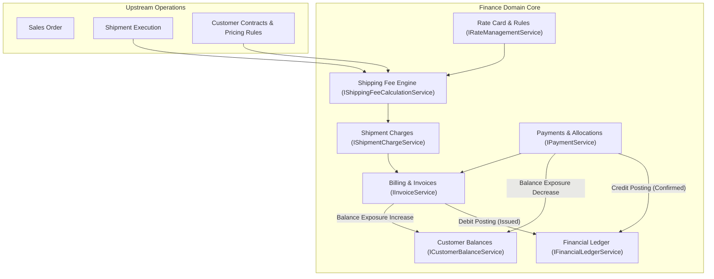

# Finance & Billing Architecture Specification

## 1. Architectural Overview & Boundaries

The **Finance & Billing Module** provides financial accounting, pricing resolution, revenue capture, invoicing, payment settlement, customer receivable balances, and general ledger journalizing for the internal Logistics Management System.

Built within the **Modular Monolith + Clean Architecture** framework (.NET 9.0), it strictly decouples commercial billing operations from transport and warehouse fulfillment while providing automated integration hooks across Orders, Shipments, Customer Contracts, and Branch Security scopes.

---

## 2. Clean Architecture Layer Organization

### Domain Layer (`Logistics.Server.Domain.Entities.Finance`)
Zero external dependencies. Houses all 12 enterprise finance entities:
- `ShippingRateCard` & `ShippingRateRule`: Carrier/internal rate table hierarchies.
- `ShipmentCharge`: Persisted, immutable fee components attached to shipments.
- `Invoice` & `InvoiceItem`: Formal billing instruments with subtotal, tax rate, and computed outstanding balance.
- `Payment` & `PaymentAllocation`: Cash/bank settlements with many-to-many allocation against unpaid invoices.
- `CustomerBalance`: Real-time receivables, unbilled charges, and COD holding with optimistic concurrency (`RowVersion`).
- `FinancialLedgerEntry`: Immutable double-entry financial audit trail with running balances.
- `CODCollection`, `CODRemittance`, `CODRemittanceItems`: Delivery cash collection and remittal records.

### Application Layer (`Logistics.Server.Application.Modules.Finance`)
- **DTOs (`DTOs/FinanceDtos.cs`)**: Strongly typed request/response models.
- **Service Interfaces (`Services/IFinanceServices.cs`)**:
  - `IRateManagementService`
  - `IShippingFeeCalculationService`
  - `IShipmentChargeService`
  - `IInvoiceService`
  - `IPaymentService`
  - `ICustomerBalanceService`
  - `IFinancialLedgerService`
- **Validators (`Validators/FinanceValidators.cs`)**: FluentValidation rules guarding numeric ranges, date consistency, and business constraints.

### Infrastructure Layer (`Logistics.Server.Infrastructure.Services.FinanceServices.cs`)
- Direct integration with `ApplicationDbContext` (schema `finance`).
- Transactional integrity and sequential number generation via `INumberSequenceService` (`INVOICE`, `PAYMENT`, `LEDGER`).
- Audit event journalizing via `IAuditLogService` into `audit.AuditLogs`.
- Optimistic concurrency control handling via EF Core `DbUpdateConcurrencyException`.

### API Presentation Layer (`Logistics.Server.API.Controllers.Finance`)
RESTful HTTP endpoints exposing JSON payloads under `/api/v1/finance/...`:
- `RateCardsController`: `/api/v1/finance/rate-cards`
- `ShippingFeesController`: `/api/v1/finance/shipping-fees`
- `InvoicesController`: `/api/v1/finance/invoices`
- `PaymentsController`: `/api/v1/finance/payments`
- `CustomerBalancesController`: `/api/v1/finance/customer-balances`
- `FinancialLedgerController`: `/api/v1/finance/ledger`

---

## 3. Financial Invariants & Accounting Rules

1. **Precision & Rounding**:
   - All monetary calculations are performed in `decimal(19,4)` to eliminate floating-point drift.
   - Database columns store financial amounts with exact scale and precision matching central accounting standards.
2. **Immutable General Ledger**:
   - Financial ledger entries are strictly append-only.
   - Deletion and in-place updates of ledger entries are forbidden. Corrective adjustments are executed via reverse offsetting entries.
3. **Double-Entry Receivable Tracking**:
   - Invoicing an order/shipment creates a **Debit** entry (`ReceivableInvoice`), increasing the customer's balance.
   - Cancelling an invoice creates a **Credit** entry (`InvoiceCancellation`), decreasing the customer's balance.
   - Registering a payment creates a **Credit** entry (`CustomerPayment`), decreasing the customer's balance.
4. **Computed Balance Integrity**:
   - In `Invoice`, `OutstandingAmount` is computed as `[TotalAmount] - [PaidAmount]`.
   - Payment allocation decreases the invoice's outstanding amount and transitions the status from `Issued` to `PartiallyPaid` or `Paid`.
   - Reversing an allocation restores the outstanding balance and reverts the status appropriately.
5. **Optimistic Concurrency**:
   - `CustomerBalance` maintains a `RowVersion` byte timestamp. Concurrent balance mutations trigger immediate re-evaluations to prevent lost updates.

---

## 4. Multi-Branch Security & Data Isolation

All finance operations validate customer branch assignments:
- Every customer record is anchored to an operating branch (`Customer.BranchId`).
- Finance operators without super-admin privileges can only view and manage invoices, charges, and balances for customers within their authorized branch access list (`_currentUser.HasBranchAccess(customer.BranchId)`).
- Cross-branch access violations immediately yield HTTP `403 Forbidden` (`ForbiddenAccessException`).
