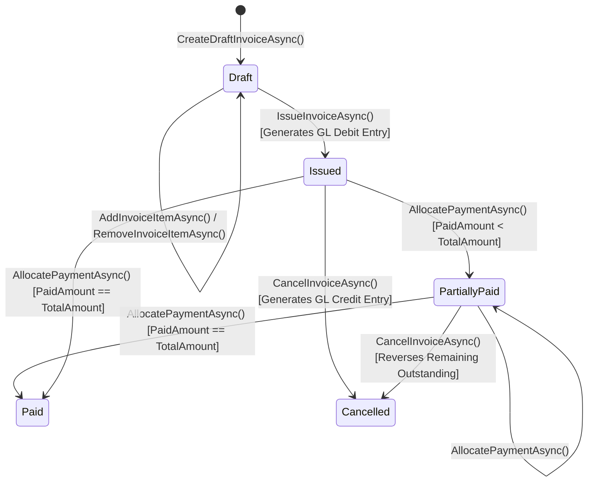

# Invoice & Billing Management

## 1. Invoice Lifecycle & State Machine

Invoices represent legal billing instruments presented to corporate or individual customers for logistics services rendered.

### State Definitions
- **`Draft`**: Editable staging invoice. Line items may be added or removed. Not reflected on customer outstanding balance or general ledger.
- **`Issued`**: Formal invoice issued to customer. Line items become immutable. Generates general ledger debit entry and updates customer receivable balance.
- **`PartiallyPaid`**: One or more payments have been allocated, but `PaidAmount < TotalAmount`.
- **`Paid`**: Fully satisfied (`PaidAmount == TotalAmount`, `OutstandingAmount == 0`).
- **`Cancelled`**: Voided by billing administrator with mandatory reason. Offsets customer balance and posts a reversing general ledger credit entry.

---

## 2. Automatic Sequential Numbering

Invoices are assigned formal legal invoice numbers via `INumberSequenceService`:
- Prefix: `INV`
- Pattern: `INV-YYYYMM-######` (e.g., `INV-202611-000001`)
- Scoped to month with guaranteed sequential monotonicity and concurrent thread safety.

---

## 3. Financial Computations & Taxes

- **SubTotal**: $\sum (\text{Quantity} \times \text{UnitPrice})$ of all line items.
- **TaxRate**: Statutory VAT percentage (e.g., 8.0% or 10.0%).
- **TaxAmount**: Calculated as $\text{SubTotal} \times \left(\frac{\text{TaxRate}}{100}\right)$ or aggregated item-level tax overrides.
- **TotalAmount**: $\text{SubTotal} + \text{TaxAmount}$.
- **PaidAmount**: Cumulative sum of confirmed `PaymentAllocations`.
- **OutstandingAmount**: SQL Server computed column: `[TotalAmount] - [PaidAmount]`.

---

## 4. General Ledger Integration on Issuance & Cancellation

- **On Issuance (`IssueInvoiceAsync`)**:
  - Validates non-empty line items and total amount $> 0$.
  - Posts `FinancialLedgerEntry`:
    - EntryType: `ReceivableInvoice`
    - ReferenceType: `Invoice`
    - ReferenceId: `invoice.Id`
    - DebitAmount: `invoice.TotalAmount`
    - CreditAmount: `0`
    - Customer running balance increases by `TotalAmount`.
- **On Cancellation (`CancelInvoiceAsync`)**:
  - Reverses any unpaid portion via offsetting credit `FinancialLedgerEntry`:
    - EntryType: `InvoiceCancellation`
    - ReferenceType: `Invoice`
    - DebitAmount: `0`
    - CreditAmount: `invoice.OutstandingAmount`
    - Customer running balance decreases by cancelled amount.
  - Releases associated `ShipmentCharges` (`IsInvoiced = false`) so they can be re-billed.
