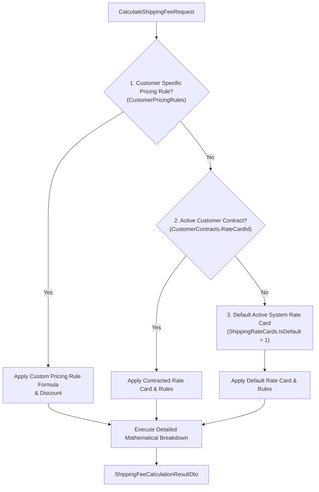

# Shipping Fee Calculation Engine

## 1. Engine Purpose & Overview

The **Shipping Fee Calculation Engine** (`IShippingFeeCalculationService`) provides deterministic, transparent, and multi-tiered price discovery for shipping operations.

It is invoked during order drafting, waybill generation, ad-hoc rating inquiries, and carrier cross-comparison workflows.

---

## 2. Priority Resolution Hierarchy

To support complex B2B commercial agreements, pricing rules resolve through a strict three-tier priority hierarchy:

### Tier 1: Customer Pricing Rules (`crm.CustomerPricingRules`)
- Specific to customer and service type (e.g. `StandardGround`, `NextDayExpress`).
- Supports discount percentages, fixed flat rates, or customized per-kg multipliers.
- Highest precedence; overrides general cards when active and within date range.

### Tier 2: Customer Contract (`crm.CustomerContracts`)
- Negotiated corporate contracts linking the customer to an exclusive `ShippingRateCardId`.
- Evaluated when no granular pricing rule matches the service.

### Tier 3: Default System Rate Card (`finance.ShippingRateCards`)
- System-wide fallback card where `IsDefault = true` and `IsActive = true`.
- Applied for standard retail, guest, or uncontracted customers.

---

## 3. Mathematical Fee Breakdown & Formulas

The total shipping fee is calculated using discrete components:

### 1. Base Rate & Incremental Weight Charge
$$\text{WeightCharge} = \max(0, \text{ChargeableWeight} - \text{FromWeightKg}) \times \text{AdditionalPerKgRate}$$

$$\text{Subtotal} = \text{BaseRate} + \text{WeightCharge}$$

### 2. Minimum Fee Floor
$$\text{FloorAdjustedSubtotal} = \max(\text{Subtotal}, \text{MinimumFee})$$

### 3. Surcharges & Extras
$$\text{SurchargeAmount} = \text{FloorAdjustedSubtotal} \times \left(\frac{\text{SurchargePercent}}{100}\right)$$

### 4. Ancillary Value-Added Services
- **Insurance Fee**: Calculated as a percentage of `DeclaredValue` above the statutory liability threshold (typically 0.5% - 1.0%).
- **COD Collection Fee**: Applied to shipments with `CodAmount > 0` covering cash handling and remittance risk (typically 1.0% with minimum fee).

### 5. Customer Discounts
$$\text{DiscountAmount} = (\text{FloorAdjustedSubtotal} + \text{SurchargeAmount}) \times \left(\frac{\text{DiscountPercent}}{100}\right)$$

### 6. Final Gross Total
$$\text{TotalAmount} = \text{FloorAdjustedSubtotal} + \text{SurchargeAmount} + \text{InsuranceFee} + \text{CodFee} - \text{DiscountAmount}$$

---

## 4. Snapshot Persistence & Auditability

When a shipment moves from draft to confirmed/ready status:
- A snapshot `ShipmentCharge` is persisted for each component (`BaseFreight`, `WeightSurcharge`, `FuelSurcharge`, `Insurance`, `CODHandling`).
- Changes in rate cards or customer pricing rules after shipment creation do not retroactively alter previously created shipment charges.
- Manual adjustments (such as address changes or remote delivery supplements) are appended as distinct adjustment charges with audit notes.
