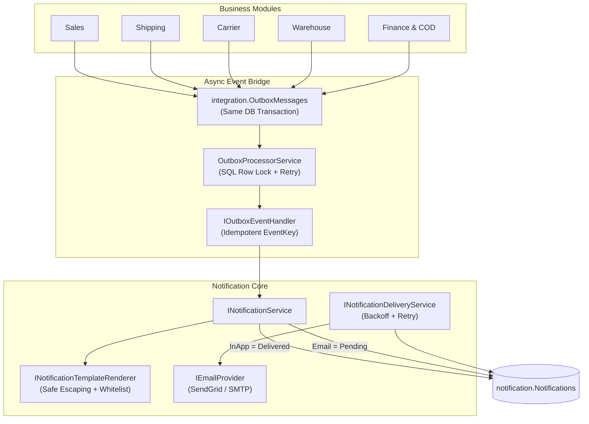

# Notification Architecture Specification

## 1. Architectural Overview & Module Boundaries

The **Notification Module** provides centralized, multi-channel alerting (In-App and Email), parameterized template rendering, and delivery attempt tracking across all internal logistics modules (`Sales`, `Shipping`, `Carrier`, `Warehouse`, `Finance`, `COD`, `Reporting`).

It adheres strictly to **Clean Architecture** and **Modular Monolith** dependency boundaries:
- **Zero Circular Dependencies**: Business modules never call `INotificationService` directly for cross-module workflows; instead, they emit versioned `IntegrationEventBase` events via `IOutboxService`, which are dispatched asynchronously by `OutboxProcessorService` into registered `IOutboxEventHandler` adapters.
- **Direct Application Usage**: Services or controllers within the Notification domain (or admin operations) use `INotificationService`, `INotificationTemplateService`, and `INotificationDeliveryService`.



---

## 2. Clean Architecture Layer Mapping

| Layer | Namespace / Location | Responsibilities |
| :--- | :--- | :--- |
| **Domain** | `Logistics.Server.Domain.Entities.Notification` | `Notification`, `NotificationTemplate`, `NotificationDelivery`, `ReportDefinition`, `ScheduledReport`. |
| **Application** | `Logistics.Server.Application.Modules.Notification` | DTOs (`NotificationDto`, `EmailSendRequest`, etc.), service contracts (`INotificationService`, `INotificationTemplateService`, `INotificationTemplateRenderer`, `INotificationDeliveryService`, `IEmailProvider`), FluentValidation validators, and permissions (`AppPermissions.Notification`). |
| **Integrations** | `Logistics.Server.Integrations.Email` | `EmailSettings`, `ConfigurableEmailProvider` (`SendGrid` HTTP provider and `SmtpClient` provider). |
| **Infrastructure** | `Logistics.Server.Infrastructure.Services` | `NotificationTemplateRenderer`, `NotificationTemplateService`, `NotificationService`, `NotificationDeliveryService`, and 15 `OutboxNotificationHandlerBase<T>` event handlers. |
| **API** | `Logistics.Server.API.Controllers.Notifications` | `NotificationsController`, `NotificationTemplatesController`. |
| **Worker** | `Logistics.Server.Worker.Jobs` | `NotificationDeliveryWorkerJob` background delivery daemon. |

---

## 3. Supported vs Unsupported Capabilities (Schema Limitations)

1. **User Notification Preferences (Unsupported in Current Schema)**:
   - The current 90-table baseline schema does not include a `UserNotificationPreferences` table. Per design constraints, no undocumented settings table was silently added.
   - **Proposed Schema Extension (Future)**:
     ```sql
     CREATE TABLE [notification].[UserNotificationPreferences] (
         [Id] BIGINT IDENTITY(1,1) PRIMARY KEY,
         [UserId] BIGINT NOT NULL REFERENCES [identity].[UserAccounts]([Id]),
         [NotificationType] NVARCHAR(100) NOT NULL,
         [Channel] NVARCHAR(50) NOT NULL,
         [IsEnabled] BIT NOT NULL DEFAULT 1,
         [IsMandatoryOperational] BIT NOT NULL DEFAULT 0, -- Critical operational alerts cannot be suppressed
         CONSTRAINT [UQ_UserNotificationPref] UNIQUE ([UserId], [NotificationType], [Channel])
     );
     ```
2. **SMS & Webhook Direct Notification Channels**:
   - `Notifications.Channel` allows `InApp`, `Email`, `SMS`, `Webhook`. Currently `InApp` and `Email` (`SendGrid` / `Smtp`) are actively implemented. `SMS` and direct `Webhook` notification channels fail explicitly with a descriptive error (`No active outbound provider`) rather than returning synthetic success.
3. **Real-Time Push (SignalR)**:
   - SignalR is not configured in the repository. In-App notifications persist cleanly in `notification.Notifications` and are retrieved via `/api/v1/notifications` and `/api/v1/notifications/unread-count`.
4. **Template Versioning & Multi-Language Columns**:
   - `notification.NotificationTemplates` has no `Version` or `Language` column. Instead, `NotificationService` renders and stores an immutable snapshot of `Title` and `Content` at creation time so historical notifications remain unaffected when templates are subsequently modified.
