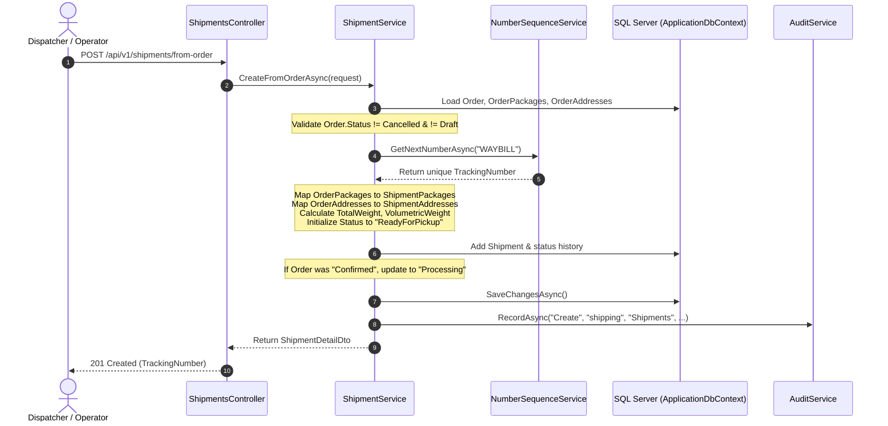

# Order to Shipment Flow

## 1. Conceptual Distinction: Order vs. Shipment

| Attribute | Sales Order (`sales.Orders`) | Shipment (`shipping.Shipments`) |
| :--- | :--- | :--- |
| **Domain** | Commercial & Sales Contract | Operational Transport & Logistics Execution |
| **Purpose** | Customer commercial commitment to buy logistics services/goods | Physical transportation movement (waybill/consignment) |
| **Status Examples** | `Draft`, `Confirmed`, `Processing`, `Delivered`, `Cancelled` | `ReadyForPickup`, `PickedUp`, `InTransit`, `OutForDelivery`, `Delivered` |
| **Identifier** | Commercial Order Number (e.g. `ORD-202611-0001`) | Operational Tracking Number (e.g. `WAYBILL-202611-0001`) |
| **Relationship** | 1 Order can originate 1 or more Shipments | Each Shipment is linked to at most 1 Order (or walk-in) |
| **Mutability** | Editable during `Draft`; items locked upon confirmation | Editable in `Draft` & `ReadyForPickup`; locked in transit |

---

## 2. Creation Pipeline

---

## 3. Package and Address Propagation Rules

1. **Package Propagation**:
   - Every `OrderPackage` selected from the source order generates a corresponding `ShipmentPackage` with identical weight, dimensions, volumetric weight (`(L×W×H)/5000`), and declared value.
   - If `OrderPackageId` is specified, it links back to the originating `OrderPackage` for traceability.
   - An `OrderPackage` cannot be assigned to multiple active shipments concurrently.

2. **Address Propagation**:
   - Order addresses typed `Sender` or `Pickup` are mapped to `ShipmentAddress` with `AddressType = "Sender"`.
   - Order addresses typed `Recipient` are mapped to `ShipmentAddress` with `AddressType = "Recipient"`.
   - Addresses in `ShipmentAddresses` are snapshots: changing customer addresses or order addresses later will not mutate the operational delivery instructions of already-dispatched shipments.
