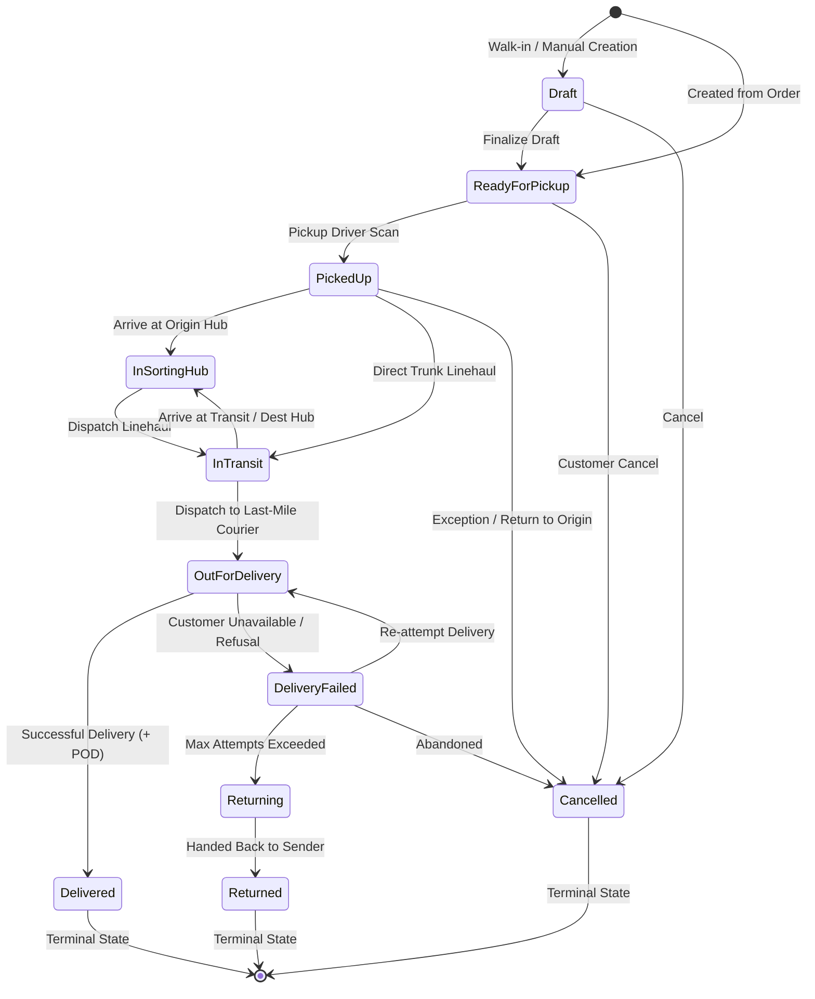

# Shipment Lifecycle & State Machine

## 1. State Machine Diagram

---

## 2. State Transition Matrix

| From Status | Allowed Target Statuses | Operation / Trigger | Required Role / Permission |
| :--- | :--- | :--- | :--- |
| `Draft` | `ReadyForPickup`, `Cancelled` | Status transition or cancellation | `shipping.shipments.manage-status`, `shipping.shipments.cancel` |
| `ReadyForPickup` | `PickedUp`, `Cancelled` | Driver scan / confirmation or cancel | `shipping.shipments.manage-status`, `shipping.shipments.cancel` |
| `PickedUp` | `InSortingHub`, `InTransit`, `Cancelled` | Hub receiving scan or dispatch | `shipping.shipments.manage-status` |
| `InSortingHub` | `InTransit` | Hub sorting complete & manifested | `shipping.shipments.manage-status` |
| `InTransit` | `InSortingHub`, `OutForDelivery` | Hub check-in or delivery courier dispatch | `shipping.shipments.manage-status` |
| `OutForDelivery` | `Delivered`, `DeliveryFailed` | Courier delivery attempt result | `shipping.shipments.deliver`, `shipping.shipments.manage-status` |
| `DeliveryFailed` | `OutForDelivery`, `Returning`, `Cancelled` | Schedule re-attempt or initiate return | `shipping.shipments.manage-status`, `shipping.returns.manage` |
| `Returning` | `Returned` | Delivery back to original sender | `shipping.shipments.manage-status`, `shipping.returns.manage` |
| `Delivered` | *(Terminal)* | Proof of delivery confirmed | N/A |
| `Returned` | *(Terminal)* | Return completed | N/A |
| `Cancelled` | *(Terminal)* | Shipment voided | N/A |

---

## 3. History Immutability

Every single transition inserts a row into `shipping.ShipmentStatusHistories`:
- `ShipmentId`: Target shipment internal key.
- `Status`: Target milestone status.
- `SubStatus`: Optional contextual tag (e.g., `WaitingAtGate`, `AddressNotFound`).
- `LocationBranchId` / `LocationWarehouseId`: Checkpoint location where the scan occurred.
- `ChangedByUserId`: ID of the authenticated user who initiated the transition.
- `ChangedAt`: Exact UTC timestamp.
- `Source`: Originator (`Internal`, `MobileApp`, `CarrierWebhook`, `BackgroundSync`).
- History rows are strictly **append-only** and cannot be modified or deleted.
