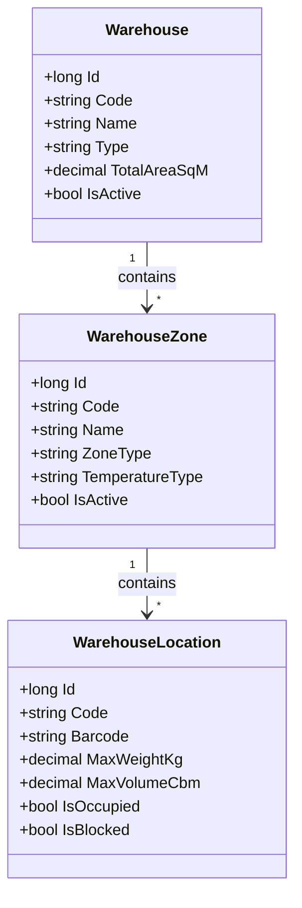

# Warehouse Management Specification

## 1. Physical Facilities Overview

The Logistics Management System organizes physical facilities into two distinct categories plus hybrid operations:
1. **Inventory Warehouses**: Facilities dedicated to storing and managing organizational products, safety stock, lot batches, and serial numbers.
2. **Parcel Sorting / Distribution Hubs**: Facilities dedicated to customer shipment transit, cross-docking, consolidation, scanning, bagging, and dispatching.
3. **Hybrid Facilities**: Facilities that combine long-term product inventory storage with parcel transit and courier staging operations.

## 2. Facility Hierarchy

### 2.1 Warehouse (`organization.Warehouses`)
- **Code**: Unique uppercase identifier per facility (e.g., `WH_SGN_01`, `HUB_HAN_NORTH`).
- **Branch Ownership**: Every warehouse strictly belongs to an operating `Branch`. Cross-branch access is strictly prohibited without appropriate authorization scope (`AccessibleBranchIds` or `SuperAdmin`).
- **Type**: `InventoryWarehouse`, `ParcelHub`, or `Hybrid`.

### 2.2 Warehouse Zones (`warehouse.WarehouseZones`)
Zones partition the physical floor into logical functional areas:
- `Receiving`: Inbound dock doors, physical parcel unloading, vendor verification.
- `BulkStorage`: Pallet racking for high-density physical inventory storage.
- `Picking`: Forward pick locations for rapid order fulfillment.
- `Staging`: Outbound holding bays prior to vehicle loading.
- `ParcelSorting`: Conveyor belts, sorting tables, and destination bag racks.
- `CrossDock`: Rapid parcel transfers without intermediate shelf storage.
- `Return`: Segregated quarantine zone for customer and carrier returns.
- `Packing`: Boxing, bagging, and label reprinting stations.

Zones also define storage conditions via `TemperatureType`:
- `Ambient` (normal dry storage)
- `Chilled` (cold chain: 2°C – 8°C)
- `Frozen` (sub-zero: -18°C)
- `AirConditioned` (temperature-controlled electronics: 20°C – 25°C)

### 2.3 Warehouse Locations (`warehouse.WarehouseLocations`)
Bin-level precision storage addresses:
- **Naming Pattern**: Standard coordinate system `Aisle-Rack-Shelf-Bin` (e.g. `A-01-02-03`).
- **Barcode**: Unique scan barcode printed on physical rack labels.
- **Physical Limits**: `MaxWeightKg` and `MaxVolumeCbm`.
- **Operational Flags**: `IsOccupied` and `IsBlocked` (preventing putaway into damaged racks).
