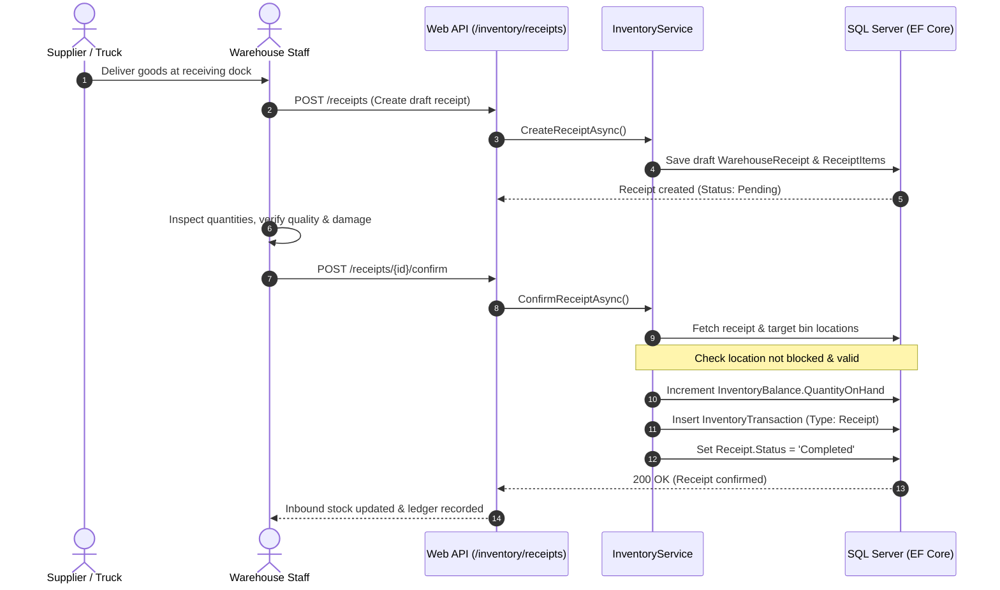
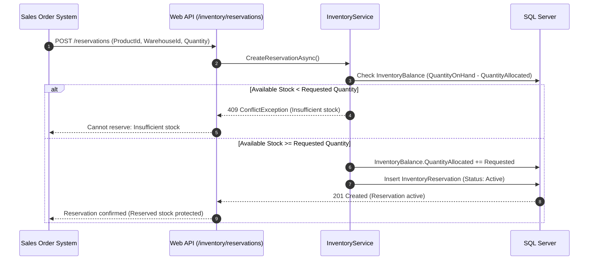
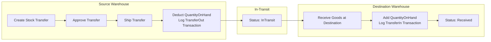

# Warehouse & Inventory Workflows

## 1. Inventory Inbound Receipt Workflow



---

## 2. Inventory Reservation & Allocation Workflow



---

## 3. Parcel Sorting Hub Workflow

```mermaid
flowchart TD
    A([Arriving Line-haul Truck]) --> B[Scan Package Barcode at Dock]
    B --> C{Scan Valid?}
    C -- No --> D[Log Exception: Unreadable Barcode]
    C -- Yes --> E[POST /parcel-handling/receive]
    E --> F[Record Unloaded Event]
    F --> G[Transition Shipment to InSortingHub]
    G --> H[Sort by Destination Hub]
    H --> I[POST /parcel-handling/sort: SortedToLane / Bagged]
    I --> J[Move to Outbound Staging Bay]
    J --> K[POST /parcel-handling/stage: StagedInBay]
    K --> L[Assign to Outbound Dispatch Manifest]
    L --> M[POST /warehouse-dispatches/{id}/confirm]
    M --> N[Transition Shipment to InTransit]
    N --> O([Departing Line-haul to Next Hub])
```

---

## 4. Stock Transfer Between Warehouses


